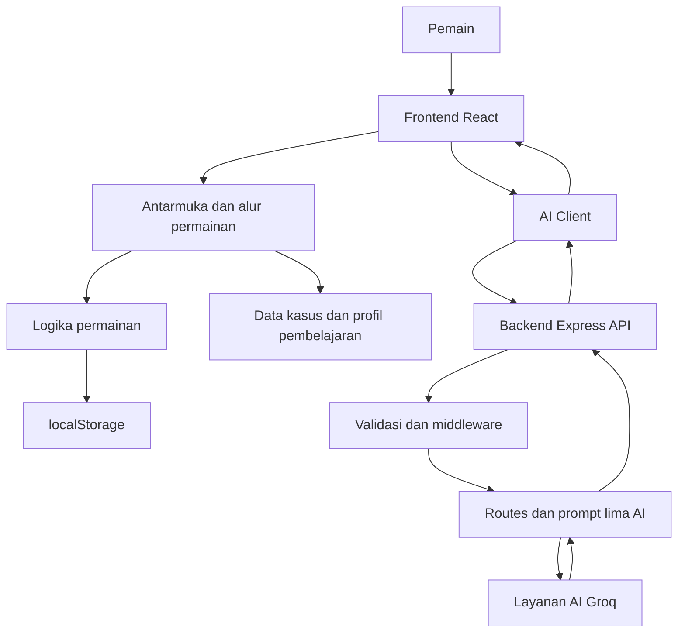

# MYSTERIA: The Academy of Hidden Knowledge

> **MYSTERIA** adalah game edukasi berbasis misteri yang menggabungkan visual novel, investigasi interaktif, pemecahan tantangan, dan pendamping belajar berbasis AI. Pemain berperan sebagai penyelidik yang mengumpulkan bukti, memeriksa informasi, menghubungkan petunjuk, dan menyusun kesimpulan.

**Tim:** KOPKOPEN  
**Target pengguna:** Siswa SMA/MA kelas X–XII  
**Platform:** Web (desktop dan perangkat mobile)  
**AI Provider:** Groq API

---

## Daftar Isi

- [Tentang MYSTERIA](#tentang-mysteria)
- [Tujuan Proyek](#tujuan-proyek)
- [Fitur Utama](#fitur-utama)
- [Profil Pembelajaran](#profil-pembelajaran)
- [Lima Identitas AI](#lima-identitas-ai)
- [Teknologi](#teknologi)
- [Arsitektur Sistem](#arsitektur-sistem)
- [Struktur Direktori](#struktur-direktori)
- [Backend API](#backend-api)
- [Penyimpanan Data](#penyimpanan-data)
- [Instalasi dan Menjalankan Lokal](#instalasi-dan-menjalankan-lokal)
- [Konfigurasi Environment](#konfigurasi-environment)
- [Pengujian dan Build](#pengujian-dan-build)
- [Deployment](#deployment)
- [Keamanan](#keamanan)
- [Pengembangan Kasus](#pengembangan-kasus)
- [Tim](#tim)

---

## Tentang MYSTERIA

MYSTERIA menghadirkan pembelajaran dalam bentuk cerita investigasi. Pemain tidak hanya menerima materi atau menjawab soal, tetapi diajak memahami situasi, mencari petunjuk, mengevaluasi informasi, dan membangun kesimpulan berdasarkan bukti.

Kasus pertama yang dikembangkan adalah **MYS-001 — The Last Drop**.

## Tujuan Proyek

MYSTERIA dirancang untuk:

1. Membuat proses belajar lebih kontekstual melalui cerita dan investigasi.
2. Melatih rasa ingin tahu, literasi informasi, dan penalaran.
3. Mendorong pemain menggunakan bukti sebelum mengambil kesimpulan.
4. Menyesuaikan pendampingan belajar dengan jenjang, mata pelajaran, dan tingkat kesulitan.
5. Menghadirkan pendamping AI dengan karakter dan fungsi yang berbeda.

## Fitur Utama

- **Visual novel:** cerita disampaikan melalui dialog dan adegan.
- **Investigasi interaktif:** pemain menjelajahi lokasi dan memeriksa objek.
- **Pengumpulan bukti:** informasi yang ditemukan menjadi bahan penyelidikan.
- **Tantangan pembelajaran:** pemain menyelesaikan tantangan yang terintegrasi dengan kasus.
- **Papan bukti dan kesimpulan:** pemain menghubungkan informasi untuk menyusun hasil investigasi.
- **Profil pembelajaran:** pengaturan jenjang, mata pelajaran, dan tingkat kesulitan.
- **Pendamping AI:** lima identitas AI membantu pemain sesuai konteks dan perannya.

> Detail fitur dan alur permainan mengikuti implementasi yang tersedia pada versi repository.

## Profil Pembelajaran

MYSTERIA diarahkan untuk siswa SMA/MA kelas X, XI, dan XII. Profil pembelajaran digunakan untuk memberikan konteks pada pendampingan AI.

Pengaturan pembelajaran mencakup:

- **Jenjang:** SMA/MA kelas X–XII.
- **Mata pelajaran:** pilihan mata pelajaran yang tersedia di aplikasi.
- **Tingkat kesulitan:** Mudah, Menengah, dan HOTS.

Daftar mata pelajaran yang tercantum pada rancangan aplikasi meliputi Bahasa Indonesia, Bahasa Inggris, Matematika, Pendidikan Pancasila, Sejarah, PJOK, Seni dan Budaya, Fisika, Kimia, Biologi, Ekonomi, Geografi, Sosiologi, Antropologi, dan Informatika.

Ketersediaan mata pelajaran dapat berbeda sesuai konfigurasi aplikasi dan kebijakan sekolah.

## Lima Identitas AI

MYSTERIA memiliki lima identitas pendamping AI:

| Identitas | Peran dalam aplikasi |
|---|---|
| **Astra** | Pendamping AI dengan instruksi dan konteks khusus sesuai prompt Astra. |
| **Nopal** | Pendamping belajar dengan instruksi dan konteks khusus sesuai prompt Nopal. |
| **Nyx** | Pendamping latihan dan penalaran dengan instruksi khusus sesuai prompt Nyx. |
| **Rei** | Identitas AI untuk interaksi karakter/wawancara sesuai konteks kasus. |
| **Renntzy** | Companion yang membantu pemain selama proses investigasi. |

Setiap identitas memiliki prompt dan batas konteks masing-masing. Perilaku, akses informasi, dan format respons ditentukan oleh implementasi backend serta berkas prompt di repository.

## Teknologi

| Bagian | Teknologi |
|---|---|
| Frontend | React |
| Build tool | Vite |
| Bahasa pemrograman | JavaScript (ES Modules) |
| Backend | Node.js dan Express |
| Layanan AI | Groq API |
| Komunikasi AI | Backend mengirim permintaan ke layanan Groq |
| Penyimpanan progres | Browser `localStorage` |
| Deployment | Vercel (sesuaikan dengan konfigurasi deployment repository) |

Versi paket dan dependensi yang digunakan dapat dilihat pada `package.json` serta lockfile.

## Arsitektur Sistem

MYSTERIA memisahkan antarmuka permainan, logika permainan, backend, dan layanan AI.



### Alur permintaan AI

1. Pemain berinteraksi dengan salah satu pendamping AI di frontend.
2. Frontend mengirim permintaan ke backend.
3. Backend memvalidasi masukan dan konteks yang diperlukan.
4. Backend memilih instruksi/prompt sesuai identitas AI.
5. Backend mengirim permintaan ke Groq API menggunakan konfigurasi server.
6. Respons diproses oleh backend lalu dikirim kembali ke frontend.

**API key Groq harus disimpan di environment backend dan tidak boleh ditanamkan ke kode frontend atau dikirim ke browser.**

## Struktur Direktori

Berikut gambaran bagian utama project. Nama dan susunan file dapat berubah mengikuti versi repository.

```text
KOPKOPEN/
├── api/                    # Entry point/API untuk deployment, jika digunakan
├── server/
│   ├── prompts/            # Prompt untuk identitas AI
│   ├── routes/             # Endpoint backend
│   ├── services/           # Integrasi provider AI dan layanan pendukung
│   ├── app.js              # Konfigurasi aplikasi Express
│   ├── config.js           # Konfigurasi backend
│   └── index.js            # Entry point server
├── src/
│   ├── components/         # Komponen antarmuka
│   ├── data/               # Data kasus, karakter, bukti, dan kurikulum
│   ├── engines/             # Logika permainan
│   ├── services/           # Komunikasi frontend dengan backend
│   ├── styles/             # CSS dan tema
│   ├── App.jsx
│   └── main.jsx
├── tests/                  # Pengujian
├── index.html
├── package.json
├── package-lock.json
├── vercel.json
└── vite.config.js
```

## Backend API

Backend menyediakan layanan untuk komunikasi antara frontend dan pendamping AI. Endpoint yang tersedia ditentukan oleh berkas route di dalam `server/routes/`.

Kelompok route dapat mencakup fungsi seperti:

- Companion atau percakapan pendamping.
- Interogasi karakter.
- Tutor atau bantuan pembelajaran.
- Tantangan dan evaluasi jawaban.
- Evaluasi latihan.

Untuk daftar endpoint, metode HTTP, format request, dan response yang benar-benar aktif, jadikan implementasi route pada repository sebagai acuan utama.

## Penyimpanan Data

- **`localStorage`:** digunakan untuk menyimpan data progres atau pengaturan pemain yang dikelola frontend.
- **Data kasus:** disimpan dalam modul data project.
- **Profil pembelajaran:** digunakan sebagai konteks saat pemain berinteraksi dengan fitur pembelajaran dan AI.
- **Konfigurasi rahasia:** API key Groq disimpan di environment backend, bukan di `localStorage`.

## Instalasi dan Menjalankan Lokal

Pastikan Node.js dan npm sudah terpasang.

1. Clone repository:

   ```bash
   git clone https://github.com/muhammadbadranayaramadhani-hub/KOPKOPEN.git
   cd KOPKOPEN
   ```

2. Instal dependensi:

   ```bash
   npm install
   ```

3. Siapkan file environment sesuai contoh konfigurasi yang tersedia. Jangan mengisi API key pada file yang akan di-commit.

4. Jalankan aplikasi menggunakan script yang tersedia di `package.json`. Pada konfigurasi yang menyediakan script Vite, frontend dapat dijalankan dengan:

   ```bash
   npm run dev
   ```

5. Jika backend dijalankan sebagai proses terpisah, masuk ke direktori backend dan gunakan script yang tercantum pada `server/package.json`:

   ```bash
   cd server
   npm install
   npm run dev
   ```

   Nama script dan kebutuhan menjalankan frontend/backend secara bersamaan harus mengikuti konfigurasi aktual repository.

## Konfigurasi Environment

MYSTERIA menggunakan Groq API untuk layanan AI. Simpan kredensial sebagai environment variable pada backend atau platform deployment.

Contoh nama variabel yang umum digunakan:

```env
GROQ_API_KEY=isi_api_key_di_environment_lokal
```

Nama variabel, nama model, dan parameter tambahan harus mengikuti pembacaan konfigurasi pada backend project. Periksa `server/config.js` dan `server/.env.example` sebelum menjalankan aplikasi.

**Jangan pernah:**
- Menulis API key asli ke README.
- Meng-commit file `.env`.
- Menaruh API key di variabel frontend yang diekspos ke browser.
- Mengirim API key melalui source code publik.

## Pengujian dan Build

Periksa script yang tersedia pada `package.json` sebelum menjalankan pengujian.

Perintah yang umum tersedia pada project Vite:

```bash
npm run build
```

Jika repository menyediakan script test, jalankan sesuai nama script tersebut. Pastikan build dan pengujian berhasil sebelum melakukan deployment.

## Deployment

Project dapat di-deploy ke platform hosting yang mendukung frontend dan backend yang digunakan, termasuk Vercel apabila konfigurasi repository telah disiapkan untuk platform tersebut.

Sebelum deployment:

1. Pastikan build frontend berhasil.
2. Pastikan route backend dapat diakses dari frontend.
3. Tambahkan API key Groq melalui menu Environment Variables pada platform hosting.
4. Atur konfigurasi origin/CORS sesuai domain deployment.
5. Uji fitur AI dan fitur permainan setelah deployment.

Detail routing, runtime backend, dan build command mengikuti konfigurasi deployment di repository.

## Keamanan

- API key Groq hanya berada di sisi server.
- Masukan pengguna perlu divalidasi di backend.
- Jangan mempercayai data dari browser tanpa validasi.
- Batasi ukuran input dan riwayat percakapan sesuai kebutuhan aplikasi.
- Jangan menampilkan kredensial atau detail konfigurasi rahasia di log publik.
- Keputusan penting dalam permainan sebaiknya tetap ditentukan oleh logika aplikasi, bukan hanya teks respons AI.

## Pengembangan Kasus

Saat menambahkan kasus baru, periksa pola struktur kasus yang sudah ada di `src/data/cases/` dan modul data terkait.

Secara umum, pastikan:
1. ID kasus unik.
2. Data lokasi, objek, karakter, dan bukti saling konsisten.
3. Dialog dan petunjuk tidak bertentangan dengan fakta kasus.
4. Tantangan sesuai jenjang SMA/MA.
5. Alur investigasi dapat diselesaikan dari awal sampai kesimpulan.
6. Build dan pengujian tetap berhasil setelah perubahan.

## Tim

**KOPKOPEN** — Tim pengembang MYSTERIA: The Academy of Hidden Knowledge.
