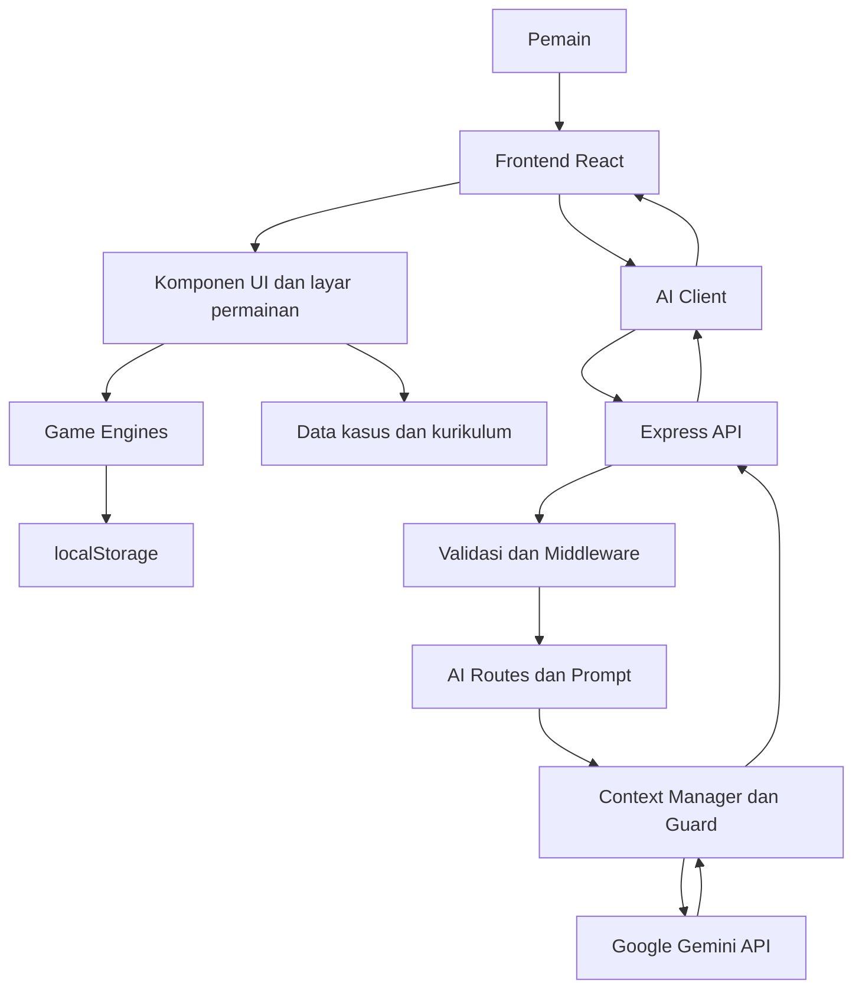

# MYSTERIA: The Academy of Hidden Knowledge

> **MYSTERIA** adalah game edukasi berbasis misteri yang menggabungkan visual novel, investigasi interaktif, pemecahan tantangan, dan pendamping belajar berbasis AI. Pemain mempelajari materi melalui proses mengumpulkan bukti, menguji informasi, menghubungkan petunjuk, dan menyusun kesimpulan.

**Tim:** KOPKOPEN  
**Target pengguna:** Siswa SMA/MA kelas X–XII  
**Kurikulum acuan:** Kurikulum Merdeka  
**Platform:** Web (desktop dan perangkat mobile)

---

## Daftar Isi

- [Latar Belakang](#latar-belakang)
- [Tujuan dan Solusi](#tujuan-dan-solusi)
- [Fitur Utama](#fitur-utama)
- [Profil Pembelajaran](#profil-pembelajaran)
- [Lima Identitas AI](#lima-identitas-ai)
- [Teknologi](#teknologi)
- [Arsitektur Sistem](#arsitektur-sistem)
- [Struktur Direktori](#struktur-direktori)
- [Dokumentasi API](#dokumentasi-api)
- [Penyimpanan Data](#penyimpanan-data)
- [Instalasi dan Menjalankan Lokal](#instalasi-dan-menjalankan-lokal)
- [Konfigurasi Environment](#konfigurasi-environment)
- [Pengujian](#pengujian)
- [Build dan Deployment](#build-dan-deployment)
- [Keamanan](#keamanan)
- [Pengembangan Kasus Baru](#pengembangan-kasus-baru)
- [Tim Pengembang](#tim-pengembang)

---

## Latar Belakang

Pembelajaran digital tidak cukup hanya menyajikan materi dan soal. Siswa juga perlu ruang untuk melatih rasa ingin tahu, kemampuan mengamati, penalaran, literasi informasi, dan pengambilan keputusan.

MYSTERIA menghadirkan materi pembelajaran dalam bentuk penyelidikan. Alih-alih hanya menjawab soal, pemain berperan sebagai penyelidik yang harus memahami situasi, menemukan bukti, menyelesaikan tantangan, dan menyusun kesimpulan berdasarkan informasi yang tersedia.

## Tujuan dan Solusi

MYSTERIA dirancang untuk:

1. Menghadirkan pengalaman belajar yang lebih kontekstual melalui cerita dan investigasi.
2. Mendorong siswa menggunakan bukti dan penalaran sebelum mengambil kesimpulan.
3. Menyesuaikan bantuan belajar dengan kelas, mata pelajaran, dan tingkat kesulitan yang dipilih.
4. Menyediakan pendamping AI dengan peran yang berbeda, tanpa menjadikan AI sebagai penentu progres atau jawaban resmi permainan.

## Fitur Utama

- **Visual novel interaktif:** cerita disampaikan melalui dialog dan adegan.
- **Investigasi titik-dan-klik:** pemain menjelajahi lokasi dan memeriksa objek atau karakter.
- **Pengumpulan bukti:** informasi yang ditemukan disimpan dalam inventaris bukti.
- **Tantangan pembelajaran:** tantangan terhubung dengan bukti dan konteks kasus.
- **Papan bukti:** pemain menghubungkan bukti dan memberikan alasan atas hubungan tersebut.
- **Wawancara karakter:** pemain dapat menggali informasi dari karakter sesuai bukti yang telah ditemukan.
- **Kesimpulan kasus:** pemain menyusun penyelesaian berdasarkan hasil penyelidikan.
- **Pendamping AI:** lima identitas AI membantu pemain melalui fungsi yang berbeda.
- **Penyimpanan progres lokal:** progres dan pengaturan pemain disimpan pada browser.

## Profil Pembelajaran

Pemain dapat mengatur profil belajar agar respons AI menyesuaikan kebutuhan pembelajaran.

| Pengaturan | Cakupan |
|---|---|
| Jenjang | SMA/MA kelas X, XI, dan XII |
| Mata pelajaran | 15 pilihan mata pelajaran |
| Tingkat kesulitan | Mudah, Menengah, dan HOTS |

Daftar mata pelajaran yang tersedia di dalam aplikasi:

- Bahasa Indonesia
- Bahasa Inggris
- Matematika
- Pendidikan Pancasila
- Sejarah
- PJOK
- Seni dan Budaya
- Fisika
- Kimia
- Biologi
- Ekonomi
- Geografi
- Sosiologi
- Antropologi
- Informatika

Pilihan mata pelajaran merupakan pilihan yang disediakan di dalam aplikasi. Ketersediaan mata pelajaran, khususnya mata pelajaran pilihan, dapat berbeda antar sekolah.

Sumber konfigurasi profil pembelajaran berada di `src/data/curriculum.js` dan digunakan oleh frontend maupun backend.

## Lima Identitas AI

MYSTERIA menggunakan lima identitas AI dengan fungsi pendampingan yang berbeda.

| Identitas | Peran utama |
|---|---|
| **RENNTZY** | Companion yang membantu pemain memahami arah penyelidikan dan memberikan petunjuk bertahap. |
| **REI** | Wawancara karakter dalam dunia kasus; respons mengikuti pengetahuan dan batas informasi masing-masing karakter. |
| **NOPAL** | Tutor yang membantu memahami tantangan dan proses penyelesaian soal. |
| **ASTRA** | Pendamping untuk kebutuhan penjelasan dan dukungan belajar sesuai konteks permainan. |
| **NYX** | Pendamping latihan yang membantu pemain berlatih dan mengembangkan penalaran. |

Respons AI disesuaikan dengan profil belajar dan konteks permainan. AI tidak diberi kewenangan untuk mengubah bukti, membuka lokasi, mengubah progres, atau menetapkan kasus selesai.

> Nama, peran, dan cakupan respons setiap identitas mengikuti implementasi prompt pada `server/prompts/`. Detail perilaku dapat berkembang mengikuti versi aplikasi.

## Teknologi

| Bagian | Teknologi |
|---|---|
| Frontend | React 18 |
| Build tool dan development server | Vite 5 |
| Bahasa utama | JavaScript (ES Modules) |
| Ikon antarmuka | Lucide React |
| Backend | Node.js dan Express 4 |
| Integrasi AI | Google Gemini melalui `@google/genai` |
| Pengujian | Node.js built-in test runner (`node:test`) |
| Penyimpanan progres | Browser `localStorage` |

Versi dependensi yang tepat mengikuti `package.json` dan lockfile pada repository.

## Arsitektur Sistem

MYSTERIA memisahkan antarmuka permainan, logika permainan, backend API, dan layanan AI.



### Alur permintaan AI

1. Frontend mengirim permintaan ke endpoint backend melalui `/api/ai/*`.
2. Backend memvalidasi input, profil belajar, riwayat percakapan, dan progres permainan.
3. Context manager menyusun konteks sesuai identitas AI dan informasi yang sudah boleh diketahui.
4. Prompt dikirim ke Google Gemini melalui layanan backend.
5. Guard memeriksa keluaran untuk mengurangi risiko spoiler, informasi di luar pengetahuan karakter, atau kebocoran jawaban.
6. Backend mengembalikan respons terstruktur ke frontend.

API key Gemini hanya digunakan di backend dan tidak dikirim ke browser.

### Prinsip pemisahan logika

- Komponen React menangani tampilan dan interaksi pemain.
- Modul `src/engines/` menangani logika permainan.
- Data kasus dan kurikulum disimpan terpisah dari komponen tampilan.
- Backend menangani validasi, konteks AI, prompt, pembatasan permintaan, dan komunikasi dengan Gemini.
- Hasil penting permainan tetap diverifikasi oleh logika aplikasi, bukan hanya berdasarkan teks dari AI.

## Struktur Direktori

Struktur berikut merangkum bagian utama repository. File tambahan dapat berubah mengikuti pengembangan.

```text
KOPKOPEN/
├── api/                       # Entry point API untuk deployment platform
├── server/
│   ├── data/                  # Data kasus dan karakter untuk backend
│   ├── middleware/            # Security, CORS, rate limiter, error handler
│   ├── prompts/               # Prompt lima identitas AI dan aturan bersama
│   ├── routes/                # Endpoint API AI
│   ├── services/              # Gemini, validasi, learner, context, guard
│   ├── app.js                 # Konfigurasi aplikasi Express
│   ├── config.js              # Konfigurasi backend dan environment
│   ├── index.js               # Entry point server
│   └── .env.example           # Contoh konfigurasi backend
├── src/
│   ├── components/            # Komponen antarmuka permainan
│   ├── data/                  # Data karakter, bukti, kasus, kurikulum
│   ├── engines/               # Logika inti permainan
│   ├── services/              # Klien API dari frontend
│   ├── styles/                # Tema dan stylesheet
│   ├── App.jsx
│   └── main.jsx
├── tests/
│   ├── engines.test.mjs       # Pengujian logika permainan
│   ├── server/                 # Pengujian endpoint dan layanan backend
│   └── helpers/                # Mock dan utilitas pengujian
├── .env.example
├── .gitignore
├── index.html
├── package.json
├── package-lock.json
├── vercel.json
└── vite.config.js
```

## Dokumentasi API

Backend menyediakan endpoint pemeriksaan layanan dan endpoint AI. Seluruh endpoint AI menggunakan prefix `/api/ai`.

| Method | Endpoint | Fungsi |
|---|---|---|
| `GET` | `/api/health` | Memeriksa status backend dan konfigurasi AI. |
| `POST` | `/api/ai/companion` | Mengakses pendamping RENNTZY. |
| `POST` | `/api/ai/interrogate` | Melakukan wawancara karakter melalui REI. |
| `POST` | `/api/ai/tutor` | Mengakses tutor NOPAL. |
| `POST` | `/api/ai/evaluate` | Memproses evaluasi jawaban atau latihan. |
| `POST` | `/api/ai/generate-challenge` | Meminta pembuatan tantangan latihan. |

### Format respons umum

Respons API menggunakan struktur JSON dengan penanda keberhasilan, data, dan informasi error. Bentuk detail properti `data` menyesuaikan endpoint.

Contoh pemeriksaan backend:

```http
GET /api/health
```

Contoh respons:

```json
{
  "success": true,
  "data": {
    "status": "ok"
  },
  "error": null
}
```

Endpoint AI menerima `POST` dengan body JSON. Data yang dikirim dapat mencakup pesan, mode, riwayat percakapan, profil belajar (`learner`), serta progres permainan (`progress`), sesuai kebutuhan endpoint.

### Validasi dan pembatasan

- Body request dibatasi ukurannya oleh backend.
- Input teks, mode, ID karakter, ID tantangan, dan profil belajar divalidasi.
- Endpoint evaluasi dan pembuatan tantangan menggunakan pembatasan permintaan yang lebih ketat.
- Karakter yang belum terbuka tidak dapat diwawancarai.
- Informasi yang belum ditemukan pemain tidak boleh dianggap sebagai bagian dari pengetahuan karakter.

## Penyimpanan Data

Versi aplikasi ini menggunakan `localStorage` browser untuk menyimpan progres dan pengaturan pemain.

- **Lokasi penyimpanan:** browser pengguna.
- **Kunci progres:** `mysteria.save.v1`.
- **Database server:** tidak menggunakan database relasional atau NoSQL pada alur penyimpanan progres yang didokumentasikan di sini.

Karena progres disimpan secara lokal, data permainan terikat pada browser dan perangkat yang digunakan. Menghapus data situs atau berpindah browser dapat menyebabkan progres lokal tidak tersedia.

## Instalasi dan Menjalankan Lokal

### Prasyarat

- Node.js `18.18` atau lebih baru.
- npm.
- API key Google Gemini untuk mengaktifkan fitur AI.

Periksa instalasi:

```bash
node --version
npm --version
```

### 1. Clone repository

```bash
git clone https://github.com/muhammadbadranayaramadhani-hub/KOPKOPEN.git
cd KOPKOPEN
```

### 2. Instal dependensi frontend dan backend

```bash
npm run install:all
```

### 3. Konfigurasi environment backend

Salin file contoh:

```bash
cp server/.env.example server/.env
```

Buka `server/.env`, lalu isi `GEMINI_API_KEY` dengan API key milik sendiri.

### 4. Jalankan backend

Buka terminal pertama:

```bash
npm run server
```

Secara default backend berjalan pada:

```text
http://127.0.0.1:8787
```

### 5. Jalankan frontend

Buka terminal kedua dari direktori proyek:

```bash
npm run dev
```

Buka alamat berikut di browser:

```text
http://localhost:5173
```

Vite meneruskan request `/api` ke backend lokal sesuai konfigurasi pada `vite.config.js`.

### 6. Menjalankan mode pengembangan backend

Jika ingin backend melakukan restart otomatis ketika file berubah:

```bash
npm run server:dev
```

## Konfigurasi Environment

Konfigurasi backend diletakkan di `server/.env`. Gunakan `server/.env.example` sebagai acuan.

| Variabel | Fungsi |
|---|---|
| `GEMINI_API_KEY` | API key Google Gemini. Wajib diisi untuk mengaktifkan AI. |
| `GEMINI_MODEL` | Nama model Gemini yang digunakan backend. |
| `GEMINI_THINKING_LEVEL` | Pengaturan tingkat reasoning jika didukung konfigurasi/model. |
| `GEMINI_THINKING_BUDGET` | Anggaran thinking jika digunakan oleh konfigurasi/model. |
| `PORT` | Port backend; default `8787`. |
| `HOST` | Host backend; default `127.0.0.1`. |
| `AI_TIMEOUT_MS` | Batas waktu permintaan ke layanan AI. |
| `RATE_LIMIT_PER_MIN` | Batas permintaan umum per IP per menit. |
| `RATE_LIMIT_HEAVY_PER_MIN` | Batas permintaan endpoint berat per IP per menit. |
| `ALLOWED_ORIGINS` | Daftar origin yang diizinkan jika frontend dan backend berbeda origin. |
| `TRUST_PROXY` | Aktifkan jika backend berada di belakang reverse proxy tepercaya. |

**Penting:** Jangan mengisi API key pada kode frontend, jangan mengunggah `server/.env`, dan jangan memasukkan secret ke repository. File `.env` harus tetap diabaikan oleh Git.

## Pengujian

Jalankan seluruh pengujian yang disediakan:

```bash
npm test
```

Pengujian HTTP:

```bash
npm run test:http
```

Pengujian menggunakan Node.js test runner dan mock AI agar pemeriksaan logika serta endpoint tidak harus memanggil layanan Gemini sungguhan.

Build frontend untuk memeriksa proses kompilasi:

```bash
npm run build
```

Hasil build frontend berada di direktori `dist/`.

## Build dan Deployment

### Build

```bash
npm run build
```

Untuk melihat hasil build secara lokal:

```bash
npm run preview
```

### Deployment

Repository menyiapkan konfigurasi deployment melalui `vercel.json` dan direktori `api/`. Sebelum deployment:

1. Pastikan build lokal berhasil.
2. Atur seluruh environment variable yang dibutuhkan pada pengaturan proyek deployment.
3. Tambahkan `GEMINI_API_KEY` sebagai secret/environment variable di platform deployment.
4. Pastikan endpoint API dan frontend menggunakan konfigurasi origin yang sesuai.
5. Jangan mengunggah file `.env` ke repository atau platform sebagai file publik.

Detail routing deployment mengikuti konfigurasi aktual pada `vercel.json` dan file di direktori `api/`.

## Keamanan

Beberapa lapisan pengamanan diterapkan pada backend:

- API key layanan AI disimpan di environment backend.
- Header keamanan dan pengaturan CORS ditangani oleh middleware.
- Ukuran body JSON dibatasi.
- Permintaan dibatasi menggunakan rate limiter.
- Input dan profil belajar divalidasi sebelum diproses.
- Konteks AI dibatasi berdasarkan progres dan bukti yang telah ditemukan.
- Keluaran AI diperiksa oleh guard untuk mengurangi spoiler dan kebocoran informasi.
- Kegagalan layanan AI tidak boleh dianggap sebagai keberhasilan atau jawaban yang valid dari permainan.

AI berfungsi sebagai pendamping pembelajaran. Status bukti, progres, evaluasi deterministik, dan penyelesaian kasus tetap berada dalam kendali logika aplikasi.

## Pengembangan Kasus Baru

Secara umum, penambahan kasus baru perlu memperhatikan pemisahan berikut:

1. **Data kasus:** definisi cerita, lokasi, objek interaktif, bukti, tantangan, hubungan bukti, dan kesimpulan.
2. **Data bukti:** identitas bukti dan informasi yang ditampilkan kepada pemain.
3. **Game engines:** aturan pengumpulan bukti, penyelesaian tantangan, hubungan bukti, dan progres.
4. **Data backend:** konteks kasus dan batas pengetahuan karakter yang digunakan oleh AI.
5. **Pengujian:** validasi alur permainan, konsistensi data, dan perilaku endpoint AI.

Pastikan data kasus yang digunakan frontend dan backend konsisten. Perubahan fakta, angka, atau urutan pengungkapan informasi perlu diperiksa pada pengujian agar tidak menimbulkan kontradiksi atau spoiler.

## Tim Pengembang

**KOPKOPEN** — Tim pengembang MYSTERIA: The Academy of Hidden Knowledge.

Repository: [KOPKOPEN](https://github.com/muhammadbadranayaramadhani-hub/KOPKOPEN)

---

<p align="center">
  <strong>MYSTERIA: The Academy of Hidden Knowledge</strong><br />
  Learn through clues. Think through evidence. Discover the truth.
</p>
